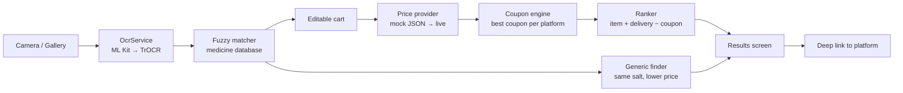
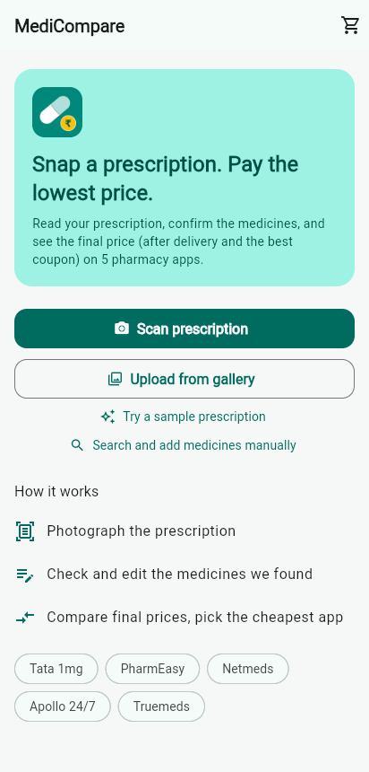
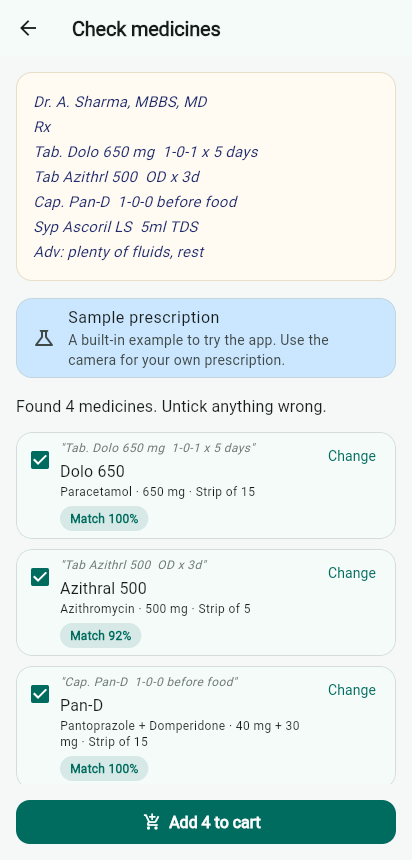
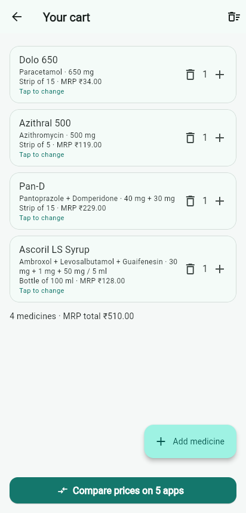
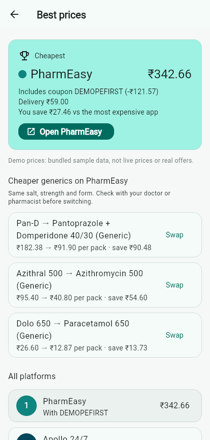

# MediCompare

> Snap a prescription. Pay the lowest price.

[](https://github.com/chiragparamesh/medicine_compare/actions/workflows/build-apk.yml)

## Problem

The same medicines cost different amounts on different pharmacy apps, and doctors' handwriting is hard to read. Patients either overpay or spend time copying medicine names into five different apps.

MediCompare reads a handwritten prescription into an editable cart, then compares the **final** price (after delivery fees and the best coupon) across Tata 1mg, PharmEasy, Netmeds, Apollo 24/7 and Truemeds. It also suggests a cheaper generic alternative.

## Features

| Feature | Status |
|---|---|
| Camera / gallery prescription picker | ✅ Built |
| On-device text recognition (Google ML Kit) on Android, behind an `OcrService` interface | ✅ Built |
| Built-in sample prescriptions ("Try a sample"; also used by the web preview) | ✅ Built |
| Fuzzy matching of OCR lines to real Indian medicine names (Levenshtein, dosage-aware) | ✅ Built |
| Medicine database: 136 common Indian brands + 96 generics | ✅ Built |
| Review screen: confirm or correct each detected medicine | ✅ Built |
| Editable medicine cart (quantity, replace, add by search) | ✅ Built |
| Prices from bundled mock JSON for 5 platforms | ✅ Built |
| Coupon rule engine (percent, flat, max cap, min order, first order) | ✅ Built |
| Results screen ranking platforms by final price (items + delivery − best coupon) | ✅ Built |
| Cheaper generic alternative (same salt, strength, form) with one-tap swap | ✅ Built |
| Deep link to the platform's search page | ✅ Built |
| "Ordered here before" per platform (disables first-order coupons, remembered) | ✅ Built |
| TrOCR handwriting model for messy doctor handwriting (fine-tuned in Colab, TFLite on device) | 🕓 Planned |
| Medicine database from a public dataset (thousands of products) | 🕓 Planned |
| Live prices | 🕓 Future |
| In-app login per platform for personal coupons | 🕓 Future |

> Prices, delivery fees and coupons in `assets/data/prices_mock.json` are **illustrative demo data**, not real offers.

## Architecture



Full design and roadmap: [docs/architecture.md](docs/architecture.md).

## Tech stack

| Layer | Choice |
|---|---|
| App | Flutter (Dart), Material 3, Riverpod, go_router |
| On-device ML | Google ML Kit text recognition (now); TensorFlow Lite TrOCR from Colab (planned) |
| Training | Google Colab, Hugging Face TrOCR, PyTorch |
| Matching | Fuzzy string matching against a medicine-name database |
| Data (current) | Bundled mock JSON in `assets/data/` |
| CI | GitHub Actions builds the release APK on every push |

## Tests

```bash
flutter test
```

Unit tests cover the coupon engine (every rule and boundary), price ranking, generic finder, fuzzy matcher and money formatting; a widget test drives scan → cart → results.

## How to run

Preview in Chrome (daily development):

```bash
flutter pub get
flutter run -d chrome
```

Install on the phone: push to GitHub, open **Actions → Build APK → latest run**, download the `medicine_compare-release-apk` artifact, unzip it and install `app-release.apk` on the Pixel 9a.

APKs are never built locally (see [CLAUDE.md](CLAUDE.md)).

## Screenshots

Web preview (Chrome) with a sample prescription and demo prices:

| Home | Check medicines | Cart | Best prices |
|---|---|---|---|
|  |  |  |  |
