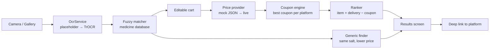

# MediCompare

> Snap a prescription. Pay the lowest price.

[](https://github.com/chiragparamesh/medicine_compare/actions/workflows/build-apk.yml)

## Problem

The same medicines cost different amounts on different pharmacy apps, and doctors' handwriting is hard to read. Patients either overpay or spend time copying medicine names into five different apps.

MediCompare reads a handwritten prescription into an editable cart, then compares the **final** price (after delivery fees and the best coupon) across Tata 1mg, PharmEasy, Netmeds, Apollo 24/7 and Truemeds. It also suggests a cheaper generic alternative.

## Features

| Feature | Status |
|---|---|
| Project skeleton, theme, routing, CI APK build | ✅ Built |
| Camera / gallery prescription picker | 🕓 Planned |
| OCR service interface with placeholder implementation | 🕓 Planned |
| Editable medicine cart | 🕓 Planned |
| Prices from bundled mock JSON for 5 platforms | 🕓 Planned |
| Coupon rule engine (percent, flat, max cap, min order, first order) | 🕓 Planned |
| Results screen ranking platforms by final price | 🕓 Planned |
| TrOCR handwriting model (fine-tuned in Colab) + fuzzy match to Indian medicine names | 🕓 Planned |
| Cheaper generic alternative | 🕓 Planned |
| Deep link to the cheapest platform | 🕓 Planned |
| In-app login per platform for personal coupons | 🕓 Future |

## Architecture



Full design and roadmap: [docs/architecture.md](docs/architecture.md).

## Tech stack

| Layer | Choice |
|---|---|
| App | Flutter (Dart), Material 3, go_router |
| On-device ML | TensorFlow Lite (`.tflite` exported from Colab) |
| Training | Google Colab, Hugging Face TrOCR, PyTorch |
| Matching | Fuzzy string matching against a medicine-name database |
| Data (current) | Bundled mock JSON in `assets/data/` |
| CI | GitHub Actions builds the release APK on every push |

## How to run

Preview in Chrome (daily development):

```bash
flutter pub get
flutter run -d chrome
```

Install on the phone: push to GitHub, open **Actions → Build APK → latest run**, download the `medicine_compare-release-apk` artifact, unzip it and install `app-release.apk` on the Pixel 9a.

APKs are never built locally (see [CLAUDE.md](CLAUDE.md)).

## Screenshots

_Coming soon._

| Scan | Cart | Results |
|---|---|---|
| _todo_ | _todo_ | _todo_ |
