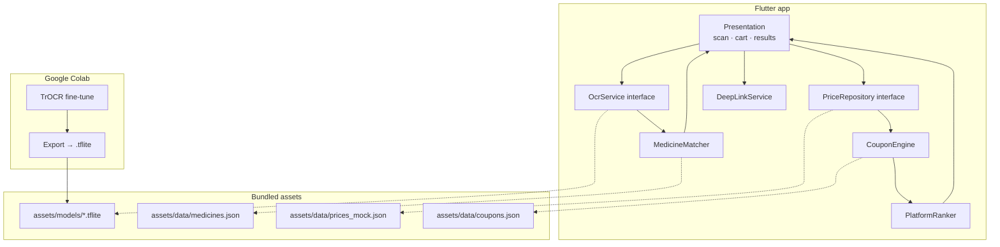

# MediCompare — Architecture

## 1. Goal

Turn a photo of a handwritten prescription into a confirmed medicine cart, then answer one question: **which pharmacy app gives me this cart for the lowest final price, and is there a cheaper generic?**

Platforms: Tata 1mg, PharmEasy, Netmeds, Apollo 24/7, Truemeds.

## 2. System overview



## 3. Layers and folders

```
lib/
  core/
    theme/      AppTheme
    router/     go_router routes
    services/   platform interfaces (image picker, OCR runtime, deep links)
    utils/      constants, money formatting, fuzzy-match helpers
    widgets/    shared widgets
  features/
    prescription_scan/   image picking + preview
    ocr/                 OcrService interface, PlaceholderOcrService, TfliteOcrService (later)
    cart/                CartItem, CartController, editable cart screen
    pricing/             PriceRepository, MockPriceRepository (assets JSON)
    coupons/             Coupon model + CouponEngine
    results/             PlatformRanker + results screen
```

Each feature follows `data/` (sources, DTOs, repositories) → `domain/` (entities, pure logic) → `presentation/` (screens, widgets, state).

## 4. Key interfaces

```dart
abstract class OcrService {
  /// Returns raw text lines read from the prescription image.
  Future<List<String>> readLines(Uint8List imageBytes);
}

abstract class MedicineMatcher {
  /// Maps a noisy OCR line to the closest real Indian medicine name(s).
  List<MedicineMatch> match(String line, {int top = 3});
}

abstract class PriceRepository {
  Future<List<PlatformQuote>> quotes(List<CartItem> cart);
}
```

- **Web preview rule:** TFLite does not run on Flutter web. `OcrService` has a placeholder implementation (returns sample lines) used on web and until the model exists; the TFLite implementation is selected only on Android.

## 5. Pricing and coupon engine

For each platform *p*:

```
subtotal(p)  = Σ price(p, item) × qty
delivery(p)  = platform delivery rule (fee, free-above threshold)
discount(p)  = max over eligible coupons c of value(c, subtotal)
final(p)     = subtotal(p) + delivery(p) − discount(p)
```

Coupon rule types supported by the engine:

| Rule | Fields | Value |
|---|---|---|
| Percent | `percent`, optional `maxCap` | `min(subtotal × percent, maxCap)` |
| Flat | `amount` | `amount` |
| Min order | `minOrder` | eligible only if `subtotal ≥ minOrder` |
| First order | `firstOrderOnly` | eligible only for a first order on that platform |

Only one coupon applies per platform; the engine picks the one with the highest discount. Results rank platforms by `final(p)`, with ties broken by delivery time if available.

Mock data shape (`assets/data/prices_mock.json`):

```json
{
  "platforms": [
    {"id": "1mg", "name": "Tata 1mg", "deliveryFee": 49, "freeDeliveryAbove": 199,
     "deepLink": "https://www.1mg.com/search/all?name={query}",
     "coupons": [{"code": "NEW25", "type": "percent", "percent": 25, "maxCap": 150, "minOrder": 300, "firstOrderOnly": true}],
     "prices": {"dolo-650": 31.5}}
  ]
}
```

## 6. ML pipeline (Colab)

See [`ml/README.md`](../ml/README.md).

1. Data: public handwritten-text datasets + synthetic prescriptions rendered in handwriting fonts with real medicine names.
2. Model: fine-tune `microsoft/trocr-small-handwritten` on line crops.
3. Constrained output: decode N-best candidates, fuzzy-match each against the medicine database (normalized edit distance + phonetic key), keep the best match above a threshold, otherwise flag for the user.
4. Export to `.tflite` (encoder + decoder, dynamic-range or int8 quantized) and copy into `assets/models/`.

**Risk:** TrOCR is an encoder-decoder transformer; converting the autoregressive decoder to TFLite is the hardest step. Fallbacks, in order: (a) TFLite encoder + Dart greedy-decode loop over a TFLite decoder step, (b) a smaller CRNN + CTC line recognizer, which converts cleanly, (c) a hosted inference endpoint. The `OcrService` interface keeps the app unaffected by which one wins.

Metrics: character error rate (CER) on line crops, and **medicine-level accuracy after fuzzy matching**, which is the number that matters to users.

## 7. Generic alternatives

Medicines are grouped by salt composition and strength (for example, paracetamol 650 mg). For the user's brand, show the cheapest product with the same salt + strength + dosage form, with a "check with your doctor/pharmacist" note.

## 8. Privacy

- Prescription images are processed on-device and not uploaded.
- No accounts in the current scope. Future platform logins use each platform's own web login in a WebView; credentials are never stored by the app.

## 9. Roadmap

| Phase | Scope |
|---|---|
| 0 ✅ | Skeleton, theme, router, CI APK build |
| 1 | Image picker, placeholder OCR, editable cart |
| 2 | Mock price JSON for 5 platforms, coupon engine + unit tests, results ranking |
| 3 | Medicine database + fuzzy matcher, generic alternatives |
| 4 | TrOCR fine-tune in Colab, TFLite export, on-device inference |
| 5 | Deep links to each platform's search/product page |
| 6 | Live prices (where permitted) and in-app platform login for personal coupons |

## 10. Testing

- Unit tests: coupon engine (every rule type and edge: exact min order, cap hit, first-order flag), ranker, fuzzy matcher.
- Widget tests: cart editing, results ordering.
- Model evaluation lives in Colab notebooks; only metrics + the `.tflite` file come back to the repo.
